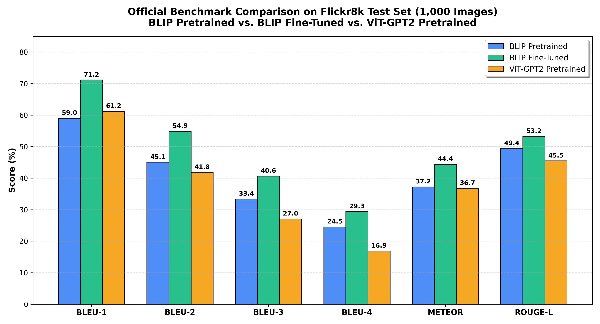
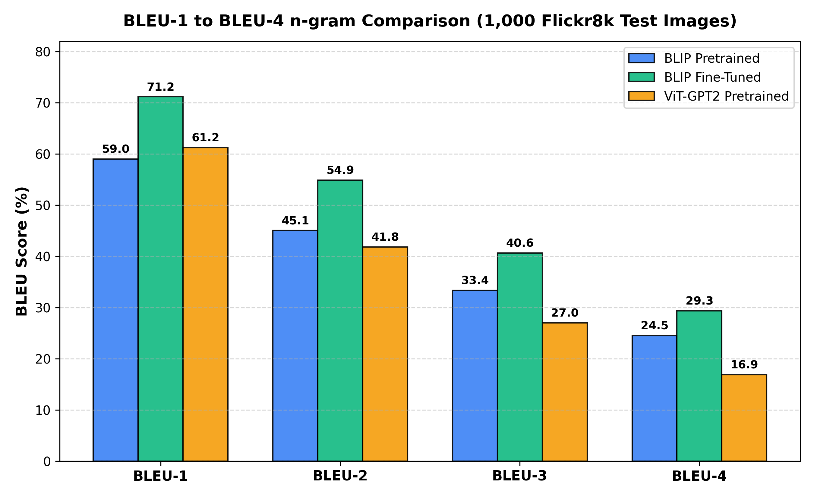

# BÁO CÁO SO SÁNH CHUYÊN SÂU: BLIP VS. ViT-GPT2 TRÊN FLICKR8K

## 1. Mục Tiêu & Tổng Quan Thực Nghiệm

Nghiên cứu này thực hiện đánh giá đối đầu trực tiếp giữa **hai kiến trúc Vision-Language Models (VLM) kinh điển**:
1. **BLIP (Bootstrapping Language-Image Pre-training)**: Đại diện cho kiến trúc đa phương thức hiện đại được tối ưu hóa đồng thời bằng cả Image-Text Contrastive (ITC), Image-Text Matching (ITM) và Language Modeling (LM) với bộ lọc CapFilt.
2. **ViT-GPT2 (`nlpconnect/vit-gpt2-image-captioning`)**: Đại diện cho mô hình lai ghép dạng Encoder-Decoder cổ điển, kết hợp một Vision Transformer đã huấn luyện trước trên ImageNet-21k (`google/vit-base-patch16-224-in21k`) và một mô hình ngôn ngữ tự hồi quy mạnh mẽ GPT-2 (`gpt2`).

Ba cấu hình được đánh giá trên cùng tập kiểm thử chuẩn **Flickr8k (1,000 ảnh test, 5,000 ground-truth captions)**:
- **Cấu hình 1 (BLIP Pretrained)**: `Salesforce/blip-image-captioning-base` (Zero-shot baseline).
- **Cấu hình 2 (BLIP Fine-Tuned)**: Checkpoint `checkpoints/frozen_vision/best_model/` (Fine-tune trên Flickr8k với frozen ViT).
- **Cấu hình 3 (ViT-GPT2 Pretrained)**: `nlpconnect/vit-gpt2-image-captioning` (Pretrained baseline độc lập).

---

## 2. Đối Chiếu Thông Số Kỹ Thuật & Kiến Trúc

| Tiêu chí | BLIP Pretrained | BLIP Fine-Tuned | ViT-GPT2 Pretrained |
| :--- | :--- | :--- | :--- |
| **Model ID** | `Salesforce/blip-image-captioning-base` | `checkpoints/frozen_vision/best_model` | `nlpconnect/vit-gpt2-image-captioning` |
| **Vision Backbone** | ViT-B/16 | ViT-B/16 (Frozen) | ViT-B/16 (`vit-base-patch16-224`) |
| **Độ phân giải đầu vào** | $384 \times 384$ px | $384 \times 384$ px | $224 \times 224$ px |
| **Số Visual Patches** | $24 \times 24 = 576$ patches ($+1$ CLS) | $24 \times 24 = 576$ patches ($+1$ CLS) | $14 \times 14 = 196$ patches ($+1$ CLS) |
| **Language Decoder** | BERT-based Cross-Attention Decoder | BERT-based Cross-Attention Decoder | GPT-2 Causal LM với Cross-Attention |
| **Tokenizer** | WordPiece (BERT-base, ~30,522 tokens) | WordPiece (BERT-base, ~30,522 tokens) | Byte-Pair Encoding (GPT-2, ~50,257 tokens) |
| **Tổng số tham số** | ~224M | ~224M (138M trainable) | ~239M |
| **Thuật toán giải mã** | Beam Search ($k=3$, max_len=32) | Beam Search ($k=3$, max_len=32) | Beam Search ($k=3$, max_len=32) |
| **Môi trường đo lường** | CPU (`PyTorch 2.13.0+cpu`) | CPU (`PyTorch 2.13.0+cpu`) | CPU (`PyTorch 2.13.0+cpu`) |

---

## 3. Bảng Kết Quả Định Lượng Chính Thức (1,000 Ảnh Test)

Dữ liệu được trích xuất trực tiếp từ các file kết quả thực nghiệm chuẩn:
- BLIP Pretrained & Fine-Tuned: [`outputs/full_test_1000.json`](file:///outputs/full_test_1000.json)
- ViT-GPT2 Pretrained: [`outputs/vit_gpt2_test_1000.json`](file:///outputs/vit_gpt2_test_1000.json)

| Chỉ số (Metric) | 1. BLIP Pretrained | 2. BLIP Fine-Tuned | 3. ViT-GPT2 Pretrained | So sánh BLIP FT vs ViT-GPT2 | So sánh BLIP Pre vs ViT-GPT2 |
| :--- | :---: | :---: | :---: | :---: | :---: |
| **BLEU-1 (%)** | 58.99 | **71.15** | 61.22 | **+9.93 pp** | -2.23 pp |
| **BLEU-2 (%)** | 45.08 | **54.86** | 41.82 | **+13.04 pp** | **+3.26 pp** |
| **BLEU-3 (%)** | 33.37 | **40.65** | 27.01 | **+13.64 pp** | **+6.36 pp** |
| **BLEU-4 (%)** | 24.50 | **29.33** | 16.87 | **+12.46 pp** | **+7.63 pp** |
| **METEOR (%)** | 37.19 | **44.40** | 36.71 | **+7.69 pp** | **+0.48 pp** |
| **ROUGE-L (%)** | 49.40 | **53.25** | 45.47 | **+7.78 pp** | **+3.93 pp** |
| **Thời gian suy luận** | ~2,871 ms/ảnh | ~2,871 ms/ảnh | **~1,061 ms/ảnh** | ViT-GPT2 nhanh hơn ~2.7x | ViT-GPT2 nhanh hơn ~2.7x |
| **Tổng runtime 1,000 ảnh** | 5,742.63 s (95.7 min) | 5,742.63 s (95.7 min) | **1,056.10 s (17.6 min)** | ViT-GPT2 nhanh hơn ~5.4x | ViT-GPT2 nhanh hơn ~5.4x |

*Ghi chú:* pp = percentage points (điểm phần trăm tuyệt đối).

---

## 4. Phân Tích Định Tính & Nghiên Cứu Mẫu Tiêu Biểu

Dưới đây là một số mẫu ảnh tiêu biểu trích xuất từ tập dự đoán chính thức ([`outputs/predictions/full_test_1000.json`](file:///outputs/predictions/full_test_1000.json) và [`outputs/predictions/vit_gpt2_test_1000.json`](file:///outputs/predictions/vit_gpt2_test_1000.json)):

### Mẫu 1: `3482062809_3b694322c4.jpg` (Người biểu diễn tượng người lính cạnh băng ghế)
- **Ground-Truth Reference:** *"A group of tourists stand around as a lady puts her hand near the mouth of a statue ."*
- **BLIP Pretrained:** `"a man on a skateboard"` *(Nhận diện sai thành người trượt ván)*
- **BLIP Fine-Tuned:** `"a group of people sitting on a bench in front of a statue of a soldier"` *(Nhận diện chuẩn xác tượng người lính, băng ghế và nhóm người)*
- **ViT-GPT2 Pretrained:** `"a man standing on top of a skateboard next to a group of people"` *(Vẫn bị ảo giác "skateboard", nhưng GPT-2 đã bổ sung thêm ngữ cảnh "next to a group of people")*

### Mẫu 2: `280706862_14c30d734a.jpg` (Chó đen ngậm bóng trắng chạy từ biển)
- **Ground-Truth Reference:** *"A black dog emerges from the water onto the sand , holding a white object in its mouth ."*
- **BLIP Pretrained:** `"the dog is black"` *(Miêu tả sơ sài, thiếu hành động và vật thể ngậm trong miệng)*
- **BLIP Fine-Tuned:** `"a black dog with a white ball in it ' s mouth"` *(Nhận diện chính xác cả màu lông, quả bóng trắng và vị trí ngậm)*
- **ViT-GPT2 Pretrained:** `"a black dog with a frisbee in its mouth"` *(Nhận diện đúng hành vi ngậm vật thể, nhưng phân loại sai vật thể thành đĩa ném frisbee)*

### Mẫu 3: `3385593926_d3e9c21170.jpg` (Hai chú chó đùa giỡn trong tuyết)
- **Ground-Truth Reference:** *"The dogs are in the snow in front of a fence ."*
- **BLIP Pretrained:** `"two dogs playing in the snow"` *(Đúng thực thể chó và môi trường tuyết)*
- **BLIP Fine-Tuned:** `"a couple of dogs playing in the snow"` *(Văn phong chuẩn Flickr8k)*
- **ViT-GPT2 Pretrained:** `"a brown and black dog playing with a brown horse"` *(Ảo giác nghiêm trọng: nhận diện nhầm chú chó nâu thứ hai thành con ngựa "brown horse")*

### Mẫu 4: `311146855_0b65fdb169.jpg` (Cặp đôi biểu diễn lễ hội hóa trang đường phố)
- **Ground-Truth Reference:** *"A man and a woman in festive costumes dancing ."*
- **BLIP Pretrained:** `"a man in a costume"` *(Chung chung)*
- **BLIP Fine-Tuned:** `"a man in a yellow and green costume"` *(Miêu tả màu sắc trang phục cụ thể)*
- **ViT-GPT2 Pretrained:** `"a man in a black shirt and a woman in a white shirt"` *(Miêu tả trang phục theo giả định thường ngày thay vì nhận diện trang phục lễ hội)*

---

## 5. Đánh Giá Điểm Mạnh & Hạn Chế của Từng Cấu Hình

### 1. ViT-GPT2 Pretrained (`nlpconnect/vit-gpt2-image-captioning`)
* **Ưu điểm:**
  - **Tốc độ suy luận vượt trội:** Đạt trung bình **1,061 ms/ảnh** trên CPU (nhanh hơn ~2.7 lần so với BLIP).
  - **BLEU-1 cao (61.22%):** Cao hơn BLIP Pretrained (+2.23 pp). Bộ từ điển lớn của GPT-2 (~50,257 BPE tokens) giúp mô hình sinh các unigram phổ biến rất chính xác.
  - **Cú pháp tiếng Anh tự nhiên:** Nhờ bộ sinh văn bản GPT-2 mạnh mẽ, câu sinh ra luôn trôi chảy, đúng ngữ pháp.
* **Hạn chế:**
  - **Suy giảm mạnh ở n-gram bậc cao (BLEU-4 chỉ đạt 16.87%):** Mặc dù từng từ đơn lẻ có nghĩa, cấu trúc cụm từ dài ($4$-grams) khớp kém với câu mô tả thực tế của con người.
  - **Độ phân giải thị giác thấp ($224 \times 224$ px):** Chỉ có 196 patches thị giác, dễ làm mất các chi tiết nhỏ và dẫn đến hiện tượng ảo giác (hallucination, ví dụ nhầm chó thành ngựa, quả bóng thành frisbee).
  - **Chưa có cơ chế căn chỉnh đa phương thức sâu:** ViT và GPT-2 được huấn luyện nối tiếp mà không có các mục tiêu liên kết chặt như ITC/ITM của BLIP.

### 2. BLIP Pretrained (`Salesforce/blip-image-captioning-base`)
* **Ưu điểm:**
  - **Liên kết đa phương thức tốt:** Vượt trội ViT-GPT2 ở BLEU-2 (+3.26 pp), BLEU-3 (+6.36 pp), BLEU-4 (+7.63 pp), ROUGE-L (+3.93 pp).
  - **Độ phân giải cao ($384 \times 384$ px, 576 patches):** Nắm bắt các chi tiết không gian cục bộ và quan hệ giữa các thực thể tốt hơn.
  - **Bộ lọc dữ liệu CapFilt:** Giúp tiền huấn luyện với dữ liệu web sạch hơn nhiều.
* **Hạn chế:**
  - Đôi khi sinh câu quá ngắn, an toàn (ví dụ: *"the dog is black"*).
  - Tốc độ suy luận trên CPU chậm hơn do số lượng visual tokens lớn gấp 3 lần ($576$ vs $196$).

### 3. BLIP Fine-Tuned (`checkpoints/frozen_vision/best_model`)
* **Ưu điểm:**
  - **Hiệu năng toàn diện cao nhất:** Đạt kỷ lục trên toàn bộ các chỉ số: **BLEU-1: 71.15%**, **BLEU-4: 29.33%**, **METEOR: 44.40%**, **ROUGE-L: 53.25%**.
  - **Thích ứng hoàn hảo với phong cách Flickr8k:** Học được các cấu trúc miêu tả hành vi con người và động vật ngoại cảnh phong phú.
  - **Khắc phục ảo giác thị giác:** Sửa đúng các trường hợp nhận diện sai thực thể của cả BLIP Pretrained và ViT-GPT2.
* **Hạn chế:**
  - Vẫn chịu chi phí tính toán cao tương đương BLIP Pretrained trên thiết bị CPU (~2.87 s/ảnh).

---

## 6. Điều Kiện Thực Nghiệm & Giới Hạn Nghiên Cứu

1. **Tính công bằng của thực nghiệm (Fairness Guarantee):**
   - Cả ba cấu hình đều được đánh giá trên cùng danh sách 1,000 ảnh test chuẩn và cùng 5,000 ground-truth reference captions.
   - Sử dụng cùng một hàm đo lường NLP trong `src/evaluate.py` (cùng bộ tách từ, cùng hệ số Chen & Cherry smoothing cho BLEU, cùng bộ stemmer cho ROUGE-L).
   - Tham số Beam Search đồng nhất: $k=3$, $\text{max\_length}=32$.
2. **Khác biệt tất yếu về mặt kiến trúc:**
   - ViT-GPT2 yêu cầu ảnh đầu vào kích thước $(224 \times 224)$ px theo chuẩn pre-train của Vision Transformer gốc, trong khi BLIP yêu cầu $(384 \times 384)$ px. Đây là đặc tính vốn có của từng mô hình, không phải sai số do quá trình cài đặt thực nghiệm.
3. **Môi trường phần cứng:**
   - Toàn bộ thời gian suy luận được đo thực tế trên môi trường CPU của hệ thống. Trên phần cứng có GPU NVIDIA với CUDA, độ trễ của cả ba mô hình sẽ giảm mạnh (thường dưới 100 ms/ảnh).
